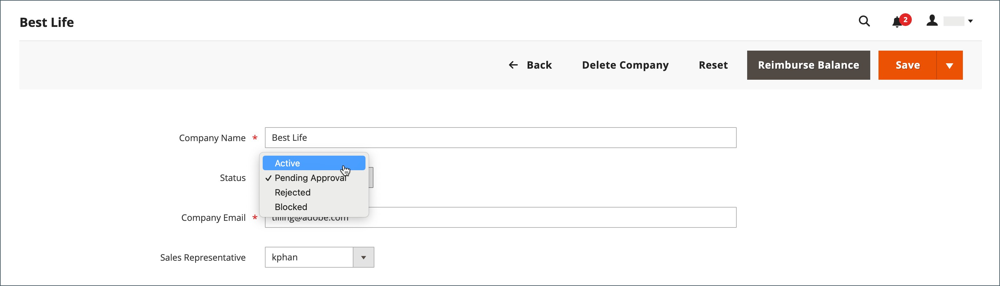

# Genehmigen eines Unternehmenskontos

Der Status der Anfragen, die von der Storefront empfangen werden, um ein Unternehmen zu erstellen, wird `Pending Approval`, bis die Anfrage vom Store-Administrator geprüft und entweder genehmigt oder abgelehnt wird. Der Status eines Unternehmenskontos kann auf einen der folgenden Werte festgelegt werden:

- [!UICONTROL Active]
- [!UICONTROL Pending Approval]
- [!UICONTROL Rejected]
- [!UICONTROL Blocked]

Sie können auch die [Aktionssteuerung“ verwenden](account-company-manage.md) um mehrere Unternehmensanfragen zu genehmigen.

{width="700" zoomable="yes"}

## Ausstehendes Firmenkonto genehmigen

1. Navigieren Sie in der _Admin_-Seitenleiste zu **[!UICONTROL Customers]** > **[!UICONTROL Companies]**.

   Sie können den _[!UICONTROL Columns]_-Selektor über dem Raster verwenden, um die Spalte **[!UICONTROL Status]**&#x200B;anzuzeigen.

1. Klicken Sie in der Spalte _[!UICONTROL Action]_&#x200B;auf **[!UICONTROL Edit]**.

1. Legen Sie **[!UICONTROL Company Status]** auf `Active` fest.

   {width="700" zoomable="yes"}

1. Wenn Sie zum Bestätigen aufgefordert werden, klicken Sie auf **[!UICONTROL Change status]**.

   Der Unternehmensadministrator erhält eine E-Mail-Benachrichtigung, dass die Firma jetzt aktiv ist.

1. Legen Sie gegebenenfalls **[!UICONTROL Sales Representative]** auf ein bestimmtes Admin-Benutzerkonto fest.

1. Erweitern Sie  den Abschnitt **[!UICONTROL Account Information]** und geben Sie im Feld **[!UICONTROL Comment]** Anmerkungen zum Konto ein.

   Die Kommentare sind in der Storefront nicht sichtbar.

1. Klicken Sie abschließend auf **[!UICONTROL Save]**.

   Der Firma und dem Unternehmensadministrator wird eine Bestätigungs-E-Mail gesendet, mit der bestätigt wird, dass das Unternehmenskonto genehmigt wurde.

## Unternehmensstatus

| Status | Beschreibung |
|------------------|--------------------------------------------------------------------------------------------------------------------------------------------|
| [!UICONTROL Active] | Das Unternehmen ist genehmigt und kann vom Unternehmensadministrator in der Storefront verwaltet werden. |
| [!UICONTROL Pending Approval] | Eine Anfrage zur Erstellung eines Unternehmenskontos wurde von der Storefront eingereicht, wird jedoch noch nicht geprüft. |
| [!UICONTROL Rejected] | Die Anforderung zum Erstellen eines Unternehmenskontos wurde vom Store-Administrator abgelehnt. |
| [!UICONTROL Blocked] | Das Firmenkonto ist nicht mehr in gutem Zustand. Der Kunde kann von der Storefront aus auf das Konto zugreifen, jedoch keine Käufe tätigen. |

{style="table-layout:auto"}
