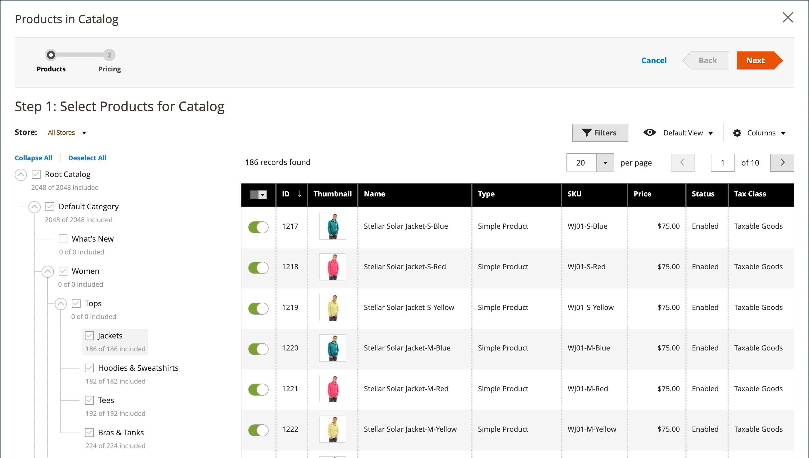

# Hinzufügen von Produkten zu einem freigegebenen Katalog

Produkte können einem freigegebenen Katalog entweder einzeln oder in Gruppen mit mehreren Produkten nach Kategorie hinzugefügt werden.

Die folgenden Anforderungen müssen erfüllt sein, damit ein komplexes Produkt (z. B. Bundle, Gruppiert oder Konfigurierbar) in der Storefront in einem freigegebenen Katalog sichtbar ist:

- Alle [zugehörigen Produkte](../catalog/product-configurations.md) und Optionen müssen demselben freigegebenen Katalog zugewiesen und im primären Katalog aktiviert sein.
- Für [konfigurierbare](../catalog/product-create-configurable.md) und [gruppierte](../catalog/product-create-grouped.md) Produkte sind nur die aktivierten zugehörigen Produkte sichtbar.
- Für ein [Bundle](../catalog/product-create-bundle.md)-Produkt müssen alle Optionen im freigegebenen Katalog enthalten sein.

  {width="600" zoomable="yes"}

## Methode 1: Ein Produkt hinzufügen

1. Navigieren Sie in der _Admin_-Seitenleiste zu **[!UICONTROL Catalog]** > **[!UICONTROL Products]**.

1. Wechseln Sie für das Produkt im Raster, das Sie hinzufügen möchten, zur Spalte _[!UICONTROL Action]_und klicken Sie auf **[!UICONTROL Edit]**.

1. Scrollen Sie nach unten, erweitern Sie  den Abschnitt _[!UICONTROL Product in Shared Catalogs]_und führen Sie die folgenden Schritte aus:

   - Aktivieren Sie das Kontrollkästchen jedes freigegebenen Katalogs, in dem das Produkt angezeigt werden soll. Um alle Kataloge auszuwählen, klicken Sie auf **[!UICONTROL Select all]**.

     {width="600" zoomable="yes"}

     Der Name jedes ausgewählten Katalogs wird im Feld _[!UICONTROL Shared Catalogs]_angezeigt.

     {width="600" zoomable="yes"}

   - Klicken Sie auf **[!UICONTROL Done]** , um die Einstellungen zu speichern.

1. Klicken Sie abschließend auf **[!UICONTROL Save]**.

## Methode 2: Mehrere Produkte hinzufügen

1. Navigieren Sie in der _Admin_-Seitenleiste zu **[!UICONTROL Catalog]** > **[!UICONTROL Shared Catalogs]**.

1. Wechseln Sie für den freigegebenen Katalog im Raster zur Spalte _[!UICONTROL Action]_und wählen Sie **[!UICONTROL Set Pricing and Structure]**aus.

1. Führen Sie in der Kategoriestruktur einen der folgenden Schritte aus:

   - Um alle Produkte einzubeziehen, klicken Sie auf **[!UICONTROL Select all]** oder aktivieren Sie das Kontrollkästchen der übergeordneten Kategorie.
   - Um bestimmte Produktkategorien einzubeziehen, aktivieren Sie das Kontrollkästchen jeder Kategorie, die Sie einbeziehen möchten.
   - Um ein einzelnes Produkt ein- oder auszuschließen, aktivieren bzw. deaktivieren Sie das Kontrollkästchen des Produkts.

   Die Notation unter jeder Kategorie in der Baumstruktur zeigt die Anzahl der Produkte aus der Kategorie an, die derzeit im freigegebenen Katalog enthalten sind. Die Notation unter der [Stammkategorie](../catalog/category-root.md) zeigt die Gesamtzahl der Produkte aus allen Kategorien an, die derzeit für den freigegebenen Katalog ausgewählt sind.

1. Um Kategorieprodukte im Raster anzuzeigen, klicken Sie auf den Namen der Kategorie in der Baumstruktur.

   Wenn eine Kategorie ausgewählt wird, geschieht Folgendes:

   - Der Umschalter in der ersten Spalte des Rasters ist für jedes ausgewählte Produkt auf `On` festgelegt.
   - Wenn ein Produkt mehreren Kategorien zugewiesen ist und in einer dieser Kategorien weggelassen wird, bleibt es in den anderen Kategorien und über [Katalogsuche](../catalog/search.md) verfügbar.
   - Das System setzt [Kategorieberechtigungen](../catalog/category-permissions.md) für die ausgewählten Produkte automatisch auf `Allow`.
