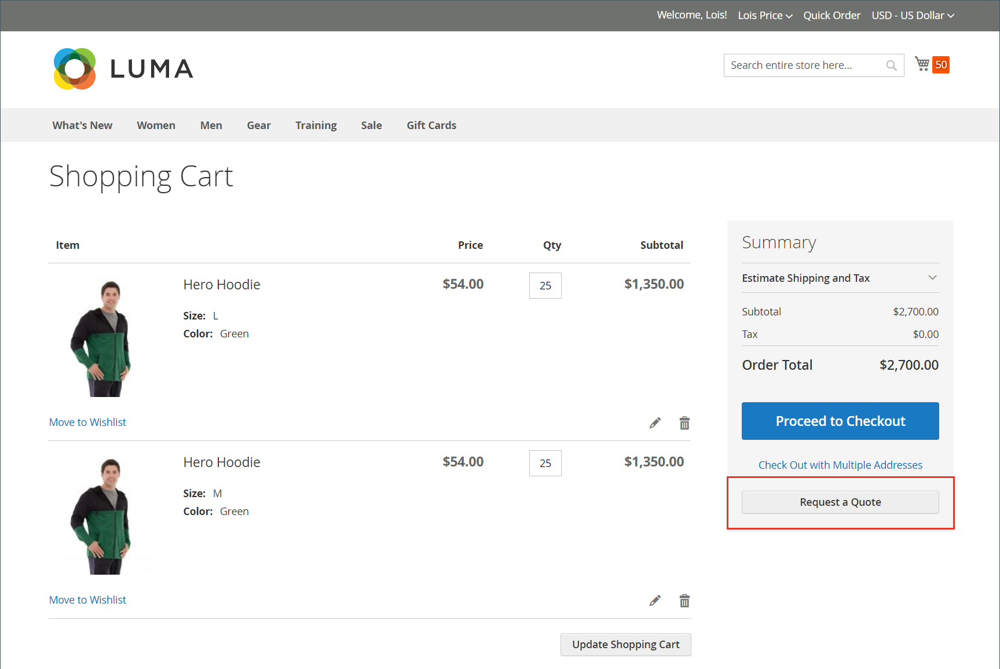

# Angebotsanfrage

Wenn Angebote in der Konfiguration [Verkaufsfunktionen](configure-quotes.md) aktiviert sind, kann ein autorisierter Käufer eines Unternehmens den Preisaushandlungsprozess starten, indem er ein Angebot aus seinem Warenkorb anfordert. Wenn ein Käufer nicht bereit ist, ein Angebot zur Verhandlung einzureichen, kann er es als Entwurf speichern.

>[!NOTE]
>
>Eine Angebotsanfrage darf keine Rabattcodes oder Geschenkgutscheine enthalten.

## Kundenerlebnis bei Angebotsanfrage

1. Der Kunde meldet sich bei seinem Benutzerkonto als Käufer mit ([) &#x200B;](account-company-roles-permissions.md), um ein Angebot anzufordern.

1. Fügt die Produkte, die im Angebot enthalten sein sollen, zum Warenkorb hinzu.

   >[!TIP]
   > 
   >Kunden können eine Liste von Produkt-SKUs mithilfe von &quot;[&quot; schneller in den Warenkorb &#x200B;](quick-order.md).

1. Wählt **[!UICONTROL Request a Quote]** aus.

   {width="700" zoomable="yes"}

1. Im **[!UICONTROL Add your comment]** Feld gibt der Kunde eine kurze Anmerkung ein, um die Anfrage zu beschreiben.

1. Gibt einen **[!UICONTROL Quote Name]** ein.

   {width="400" zoomable="yes"}

1. Hängt bei Bedarf ein unterstützendes Dokument oder Bild an das Angebot an:

   - Wählt **[!UICONTROL Attach file]** aus.
   - Wählt die Datei aus ihrem System aus.

   Standardmäßig kann eine [angehängte Datei](configure-quotes.md) bis zu 2 MB in einem der folgenden Dateiformate betragen: DOC, DOCX, XLS, XLSX, PDF, TXT, JPG oder JPEG, PNG.

1. Erstellt und verarbeitet das Angebot:

   - Sendet das Angebot an den Verkäufer durch Auswahl von **[!UICONTROL Request a Quote]**.
   - Speichert das Angebot als Entwurf, indem **[!UICONTROL Save as Draft]** ausgewählt wird.

     Wenn der Käufer das Angebot als Entwurf speichert, ist das Angebot in [!UICONTROL My Quotes] in `Draft` verfügbar. Angebotsentwürfe sind für den Verkäufer erst sichtbar, wenn der Käufer sie zur Überprüfung sendet.
