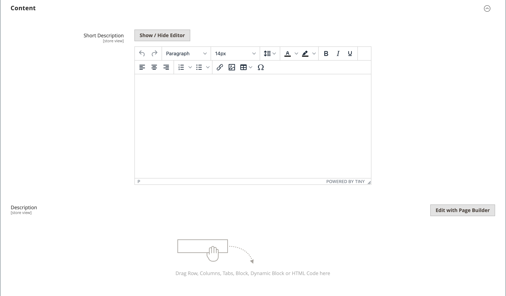
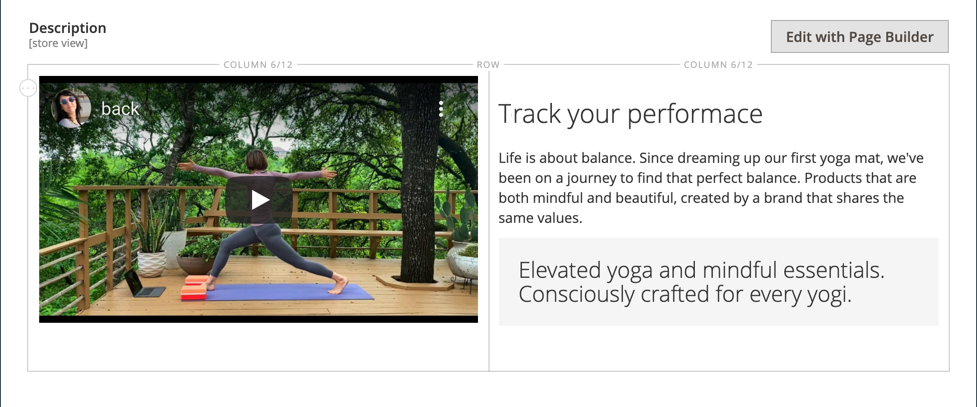
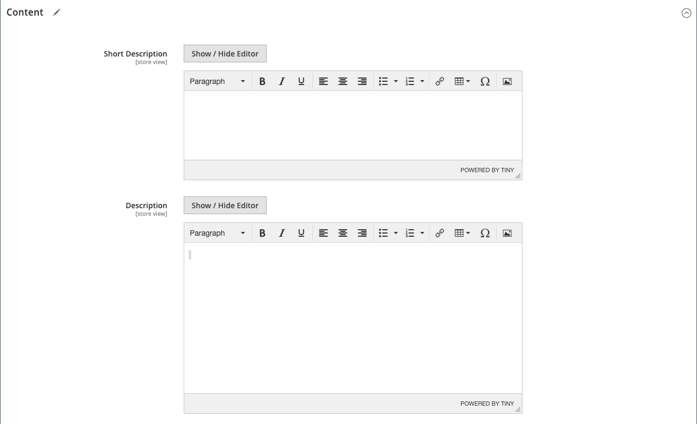

# Produkteinstellungen - [!UICONTROL Content]

Der Abschnitt _[!UICONTROL Content]_&#x200B;wird verwendet, um die Hauptproduktbeschreibung, die auf der Produktseite angezeigt wird, einzugeben und zu bearbeiten. Die Kurzbeschreibung kann in den meisten RSS-Feeds verwendet werden und kann je nach [&#x200B; auch in Kataloglisten &#x200B;](../content-design/themes.md).

>[!NOTE]
>
>Bei der Kataloganreicherung können von KI vorgeschlagene Aktualisierungen für den Produktnamen und die lange Beschreibung in diesem Abschnitt angewendet werden. Weitere Informationen finden Sie unter [Kataloganreicherung](catalog-enrichment.md).

## Hinzufügen der Produktbeschreibung in [!DNL Page Builder]

1. Öffnen Sie das Produkt im Bearbeitungsmodus.

1. Scrollen Sie nach unten und erweitern Sie  den Abschnitt **[!UICONTROL Content]** .

   {width="600" zoomable="yes"}

1. Geben Sie eine **[!UICONTROL Short Description]** des Produkts ein und verwenden Sie die [Editor-](../content-design/editor.md)), um das Produkt nach Bedarf zu formatieren.

1. Klicken Sie auf der **[!UICONTROL Description]** Beschriftung auf **[!UICONTROL Edit with Page Builder]**.

1. Verwenden Sie die [[!DNL Page Builder]](../page-builder/introduction.md)-Tools, um [vorhandenen Text zu bearbeiten](../page-builder/text.md) und bei Bedarf weitere Inhalte hinzuzufügen.

## Vorschau [!DNL Page Builder]

Wenn Sie den Abschnitt _[!UICONTROL Content]_&#x200B;für ein vorhandenes Produkt erweitern, bei dem Inhalt mit [!DNL Page Builder] erstellt wurde, wird eine Vorschau des **[!UICONTROL Description]**&#x200B;Inhalts so angezeigt, wie er auf der Produktseite angezeigt würde. Öffnen Sie den [!DNL Page Builder] Workspace, in dem Sie alle erforderlichen Aktualisierungen vornehmen können, indem Sie auf **[!UICONTROL Edit with Page Builder]**&#x200B;klicken.

{width="600" zoomable="yes"}

Diese Inhaltsvorschau ist standardmäßig für die Produkt- und Kategorieformulare aktiviert. Wenn die Leistung aufgrund des Ladens der Vorschau beeinträchtigt ist, können Sie die Vorschau in den Einstellungen [Content-Management-](../configuration-reference/general/content-management.md#advanced-content-tools)) deaktivieren.

## Hinzufügen der Produktbeschreibung im Editor

Wenn [!DNL Page Builder] für Ihren Store deaktiviert ist, verwenden Sie den Texteditor, um den Produktinhalt hinzuzufügen. Geben Sie nur ASCII-Zeichen in das Textfeld ein. Wenn Sie Text aus einem Textverarbeitungsprogramm einfügen, speichern Sie ihn zuerst als einfache TXT-Datei, um alle unsichtbaren Steuerzeichen zu entfernen. Weitere Informationen finden Sie unter [Verwenden des Editors](../content-design/editor.md).

1. Öffnen Sie das Produkt im Bearbeitungsmodus.

1. Scrollen Sie nach unten und erweitern Sie  den Abschnitt **[!UICONTROL Content]** .

   {width="600" zoomable="yes"}

1. Geben Sie einen **[!UICONTROL Short Description]** des Produkts und das Format nach Bedarf ein.

1. Geben Sie die wichtigsten **[!UICONTROL Description]** ein und verwenden Sie die Editor-Symbolleiste, um sie nach Bedarf zu formatieren.

   Sie können die untere rechte Ecke ziehen, um die Höhe des Textfelds zu ändern.
