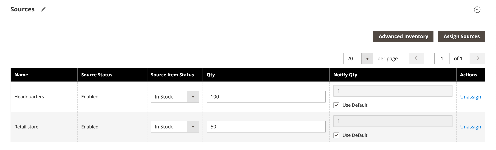

# Produkteinstellungen - [!UICONTROL Sources]

Im Abschnitt _[!UICONTROL Sources]_der Produkteinstellungen werden die Quellen aufgelistet, aus denen das Produkt verteilt werden kann. Es wird verwendet, um Quellen zuzuweisen und deren Zuweisung aufzuheben sowie die Menge und Verfügbarkeit des Produkts zu verwalten. Dieser Abschnitt wird nur angezeigt, wenn für Ihren Store mehr als eine Quelle definiert ist. Weitere Informationen zu Quellen finden Sie unter [Verwalten von Quellen](../inventory-management/sources-manage.md).

## Zuweisen einer Quelle für ein Produkt

1. Klicken Sie auf **[!UICONTROL Assign Source]**.

1. Aktivieren Sie das Kontrollkästchen für die erforderlichen Quellen.

1. Klicken Sie auf **[!UICONTROL Done]**.

1. Wählen Sie **[!UICONTROL Source Item Status]** aus und geben Sie die **[!UICONTROL Qty]** und **[!UICONTROL Notify Qty]** Werte nach Bedarf ein.

1. Klicken Sie auf **[!UICONTROL Save]** , um die Änderungen zu speichern.

{width="600" zoomable="yes"}

## Feldverweis

| Feld | Beschreibung |
|--- |--- |
| [!UICONTROL Name] | Der eindeutige Name für eine Quelle. |
| [!UICONTROL Source Status] | Bestimmt, ob das Produkt im Katalog aktiviert oder deaktiviert ist. |
| [!UICONTROL Source Item Status] | Legt die aktuelle Verfügbarkeit des Produkts fest. Optionen:  **[!UICONTROL In Stock]**- Macht das Produkt zum Kauf verfügbar. **[!UICONTROL Out of Stock]** - Sofern keine Auftragsrückstände aktiviert sind, verhindert, dass das Produkt zum Kauf zur Verfügung steht, und entfernt die Auflistung aus dem Katalog. |
| [!UICONTROL Qty] | Verfügbare Lagerbestände für jede Quelle. |
| [!UICONTROL Notify Qty] | Ein Betrag für die _Mengenbenachrichtigung_ für diese spezifische Quelle, wenn `Notify Quantity Use Default` nicht ausgewählt ist. |
| [!UICONTROL Notify Qty Use Default] | Gibt an, dass die Standardeinstellung für _Für Menge benachrichtigen_ im erweiterten Warenbestand oder die globale Einstellung in der Store-Konfiguration verwendet werden soll. Weitere Informationen zu erweiterten Inventareinstellungen für Ihr Produkt finden Sie unter [Konfigurieren erweiterter Produktoptionen](../inventory-management/product-options.md). |
| [!UICONTROL Actions] | Klicken Sie für eine zugewiesene Quelle auf **[!UICONTROL Unassign]** , damit die Quelle nicht für das Produkt verfügbar ist. Klicken Sie bei einer nicht zugewiesenen Quelle auf **[!UICONTROL Assign Sources]** , um eine Quelle für das Produkt verfügbar zu machen. Weitere Informationen zu [!UICONTROL Assign Sources] Optionen finden Sie unter [Zuweisen von Quellen pro Produkt](../inventory-management/sources-assign-per-product.md). |

{style="table-layout:auto"}

