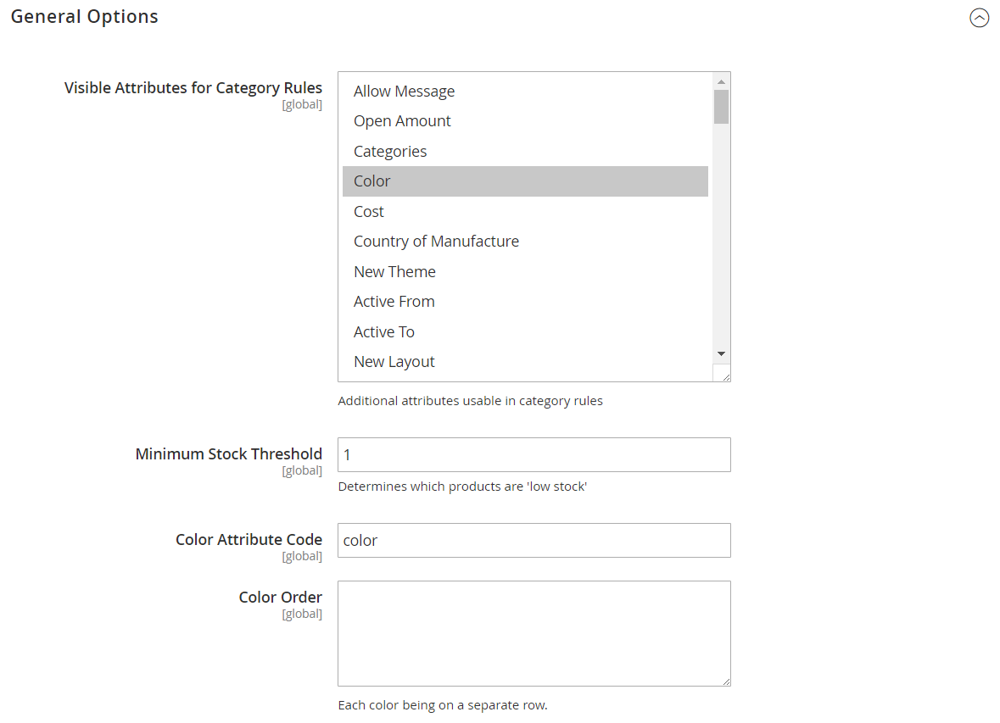

# [!UICONTROL Catalog] > [!UICONTROL Visual Merchandiser]

{{ee-feature}}

{{config}}

## [!UICONTROL General Options]

<!-- zoom -->

<!-- [General Options](https://experienceleague.adobe.com/en/docs/commerce-admin/marketing/merchandising/visual-merch/smart-attributes-configure) -->

| Feld | [Umfang](../../getting-started/websites-stores-views.md#scope-settings) | Beschreibung |
|--- |--- |--- |
| [!UICONTROL Visible Attributes for Category Rules] | Global | kennzeichnet zusätzliche Attribute, die mit Kategorieregeln verwendet werden können. Verwenden Sie die Mehrfachauswahl (Strg- oder Befehlstaste), um alle Attribute auszuwählen, die verfügbar gemacht werden sollen. |
| [!UICONTROL Minimum Stock Threshold] | Global | Bestimmt den Mindestbestandsschwellenwert für Produkte, um Produkte nach Lagerbestand zu sortieren. Standardwert: `1` |
| [!UICONTROL Color Attribute Code] | Global | Gibt das Attribut an, mit dem Produkte nach Farbe sortiert werden. Standardwert: `color` |
| [!UICONTROL Color Order] | Global | Bestimmt die Sortierreihenfolge bei der Sortierung von Produkten nach Farbe. Geben Sie jede Farbe in einer separaten Zeile ein. |

{style="table-layout:auto"}
