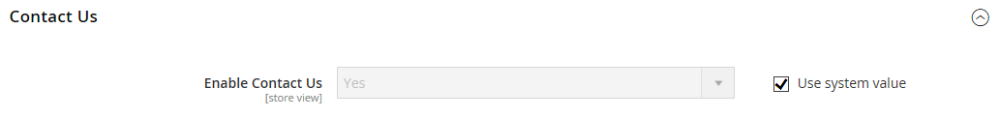
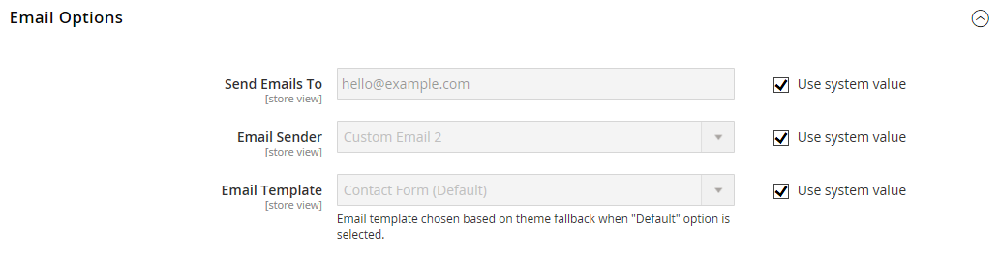

# [!UICONTROL General] > [!UICONTROL Contacts]

{{config}}

## [!UICONTROL Contact Us]

<!-- zoom -->

<!-- [Contact Us](https://experienceleague.adobe.com/de/docs/commerce-admin/start/setup/store-details#contact-us-form) -->

| Feld | [Umfang](../../getting-started/websites-stores-views.md#scope-settings) | Beschreibung |
|--- |--- |--- |
| [!UICONTROL Enable Contact Us] | Shop-Ansicht | Aktiviert die Seite [_Kontakt_](../../getting-started/store-details.md#contact-us-form) und platziert einen Link in der Fußzeile. |

{style="table-layout:auto"}

## [!UICONTROL Email Options]

<!-- zoom -->

<!-- [Email Options](https://experienceleague.adobe.com/de/docs/commerce-admin/start/setup/store-details#contact-us-form) -->

| Feld | [Umfang](../../getting-started/websites-stores-views.md#scope-settings) | Beschreibung |
|--- |--- |--- |
| [!UICONTROL Send Emails To] | Shop-Ansicht | Identifiziert die E-Mail-Adresse, die alle Antworten von der Seite _Kontakt_ erhält |
| [!UICONTROL Email Sender] | Shop-Ansicht | Identifiziert den Store-Kontakt, der für alle Antworten auf E-Mail-Anfragen von der Seite _Kontakt_ verwendet wird. Standardabsender: `Custom Email 2` |
| [!UICONTROL Email Template] | Shop-Ansicht | Gibt die Vorlage an, die als Grundlage für alle Antworten auf E-Mail-Anfragen von der Seite _Kontakt_ verwendet werden soll. Standardvorlage: `Contact Form` |

{style="table-layout:auto"}
