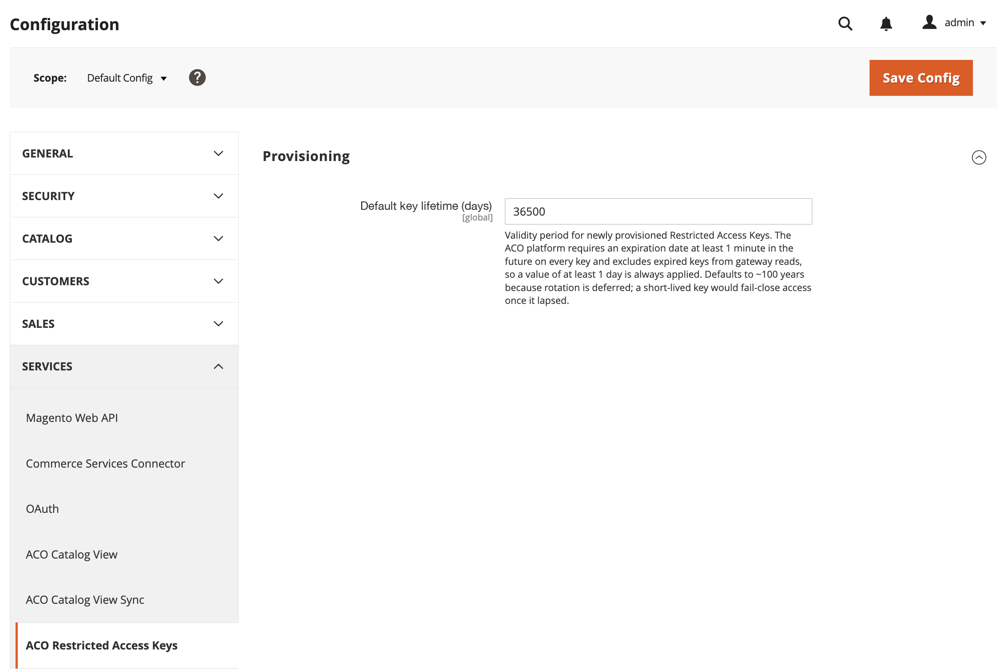

# [!UICONTROL Services] > [!UICONTROL ACO Restricted Access Keys]

Verwenden Sie diese Einstellung, um den Standardablaufzeitraum zu steuern, den die [!DNL Adobe Commerce Optimizer Connector for B2B] für eingeschränkte Zugriffsschlüssel anwendet, die sie für freigegebene B2B-Katalogansichten bereitstellt. Informationen zum Erstellen, Zuweisen und Löschen dieser Schlüssel finden Sie unter [Verwaltung von eingeschränkten Zugriffsschlüsseln](../../systems/restricted-access-keys.md).

>[!NOTE]
>
>Diese Seite gilt für den Connector. Instanzen, die mit dem Composable Catalog Data Model (CCDM) bereitgestellt werden, synchronisieren Daten nativ und verwenden den Connector nicht. Siehe [Merchandising-Services mit CCDM](/help/optimizer/overview.md).

{{config}}

## [!UICONTROL Provisioning]

<!-- zoom -->

| Feld | [Umfang](../../getting-started/websites-stores-views.md#scope-settings) | Beschreibung |
| --- | --- | --- |
| [!UICONTROL Default key expiry (days)] | Global | Gültigkeitszeitraum für neu bereitgestellte eingeschränkte Zugriffsschlüssel. [!DNL Adobe Commerce Optimizer] erfordert für jeden Schlüssel ein Ablaufdatum von mindestens einer Minute in der Zukunft und schließt abgelaufene Schlüssel aus Gateway-Lesevorgängen aus, sodass immer ein Wert von mindestens einem Tag angewendet wird. Standardwert: `36500` |

{style="table-layout:auto"}

>[!NOTE]
>
>Der Standardablauf ist auf einen langen Ablaufzeitraum festgelegt, da die automatische Schlüsselrotation noch nicht verfügbar ist. Siehe [Auswahl und Drehung von Tasten](../../systems/restricted-access-keys.md#key-selection-and-rotation).

>[!MORELIKETHIS]
>
> - [ACO-Katalogansicht](./aco-catalog-view.md) - Konfigurieren von Storefront-Zugriffstoken für Katalogansichten
> - [Verwaltung von eingeschränkten Zugriffsschlüsseln](../../systems/restricted-access-keys.md) — Erstellen, Zuweisen und Löschen von eingeschränkten Zugriffsschlüsseln
> - [Überwachung des Synchronisierungsstatus der Katalogansicht](../../systems/catalog-view-sync-status.md) — Überwacht Schlüssel, die bald ablaufen
