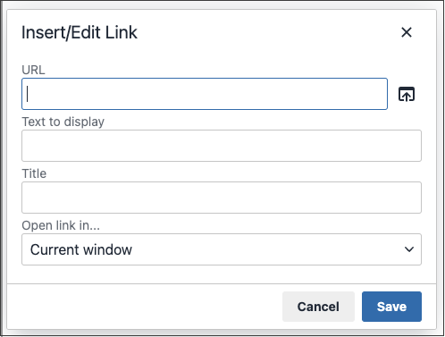

# Einfügen eines Links in den Editor

Eine einfache Möglichkeit, einen Link einzufügen, besteht darin, die Schaltfläche _Link_ in der Symbolleiste [Editor](editor.md) zu verwenden. Es sind keine Kenntnisse über HTML erforderlich und das Ergebnis ist dasselbe.

1. Wählen Sie den Text aus, in dem Sie den Link erstellen möchten.

1. Klicken Sie auf das _Link einfügen/bearbeiten_ in der Editor-Symbolleiste.

   {width="700" zoomable="yes"}

   Diese Aktion öffnet das _[!UICONTROL Insert link]_&#x200B;Dialogfeld.

   {width="250" zoomable="yes"}

1. Geben Sie **[!UICONTROL Url]** eine der folgenden Optionen ein:

   - Der URL-Schlüssel einer Seite in Ihrem Store.

   - Die vollständige URL einer zu verknüpfenden externen Seite.

1. Ändern Sie bei Bedarf die **[!UICONTROL Text to display]**.

   Der Standardwert ist der Text, den Sie für den Link ausgewählt haben. Sie können sie im Textfeld ändern.

1. Geben Sie **[!UICONTROL Title]** den QuickInfo-Text ein, der angezeigt werden soll, wenn jemand den Mauszeiger über den Link bewegt.

1. Legen Sie **[!UICONTROL Target]** auf eine der folgenden Einstellungen fest:

   - `Open link in the same window`

   - `Open in a new window`

1. Um den Link zu erstellen, klicken Sie auf **[!UICONTROL OK]**.
