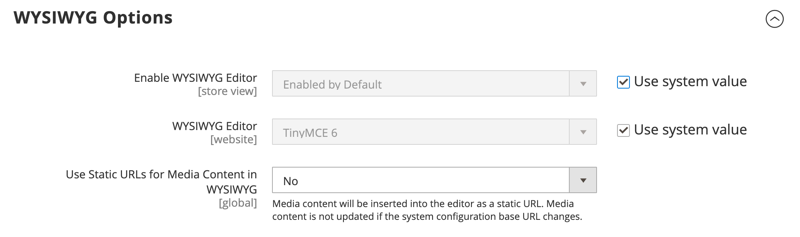

# WYSIWYG-Editor

Der Editor bietet die Möglichkeit, Daten einzugeben und zu formatieren, während Sie in einer _What You See Is What You Get_ (WYSIWYG)-Ansicht des Inhalts arbeiten. Wenn Sie lieber direkt mit dem zugrunde liegenden HTML-Code arbeiten, können Sie die Modi einfach ändern. Der Editor kann verwendet werden, um Inhalte für [Seiten](pages.md), [Blöcke](blocks.md) und [Produktbeschreibungen) &#x200B;](../catalog/product-content.md). Greifen Sie bei der Arbeit an Produktdetails auf den Editor zu, indem Sie auf **[!UICONTROL Show / Hide Editor]** klicken.

{width="700" zoomable="yes"}

Die folgenden Themen enthalten detaillierte Informationen zur Verwendung des Editors:

- [Link einfügen](editor-insert-link.md)
- [Bild einfügen](editor-insert-image.md)
- [Widget einfügen](editor-widget.md)
- [Einfügen einer Variablen](editor-insert-variable.md)

## Konfigurieren des Editors

Der WYSIWYG-Editor ist standardmäßig aktiviert und kann verwendet werden, um Inhalte auf CMS-Seiten und -Blöcken sowie in Produkten und Kategorien zu bearbeiten. In der -Konfiguration können Sie den Editor aktivieren oder deaktivieren und festlegen, dass für Medieninhalte in Produkt- und Kategoriebeschreibungen statt [dynamisch](../catalog/catalog-urls.md#dynamic-url) statische URLs verwendet werden sollen.

{width="600" zoomable="yes"}

>[!NOTE]
>
>TinyMCE wurde in Magento 2.4.6 und höheren Versionen durch Hugerte als standardmäßigen WYSIWYG-Editor ersetzt.

Eine ausführliche Beschreibung aller WYSIWYG-Optionen finden Sie unter [Content-Management](../configuration-reference/general/content-management.md) in _Konfigurationsreferenz_.

1. Navigieren Sie in _Admin_-Seitenleiste zu **[!UICONTROL Stores]** > _[!UICONTROL Settings]_>**[!UICONTROL Configuration]**.

1. Wählen Sie im linken Bedienfeld unter _[!UICONTROL General]_&#x200B;die Option **[!UICONTROL Content Management]**&#x200B;aus.

1. Erweitern Sie  **[!UICONTROL WYSIWYG Options]**.

1. Legen Sie **[!UICONTROL Enable WYSIWYG Editor]** auf Ihre Voreinstellung fest.

   Der Editor ist standardmäßig aktiviert.

1. Legen Sie **[!UICONTROL Static URLs for Media Content in WYSIWYG]** für alle [Medieninhalte“ fest](../catalog/catalog-urls.md#static-url) die Sie mit dem WYSIWYG-Editor eingeben.

1. Klicken Sie abschließend auf **[!UICONTROL Save Config]**.
