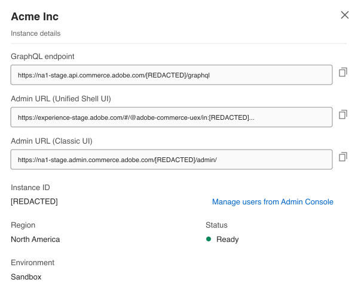
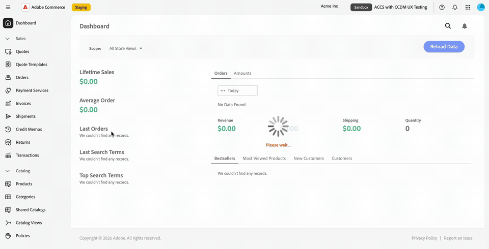
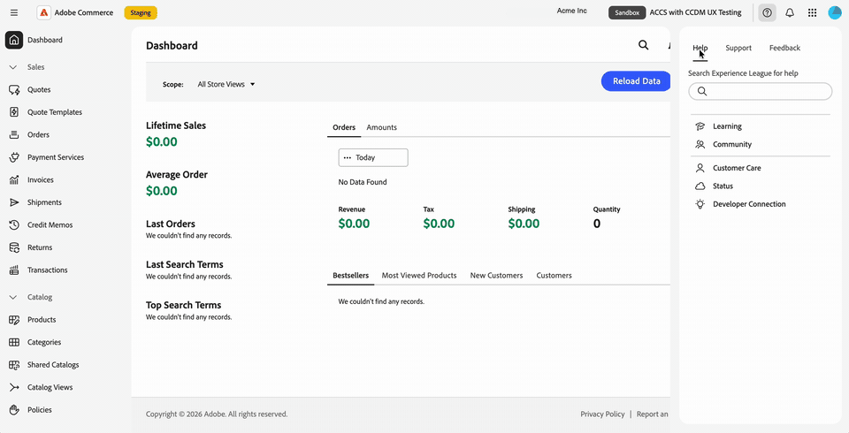

# Commerce Admin in Adobe Unified Experience

Der Commerce Admin für Adobe Commerce as a Cloud Service wird in Adobe Unified Experience geöffnet, wenn Sie einen Instanznamen in Commerce Cloud Manager auswählen.

Die einheitliche Benutzeroberfläche von Adobe bietet die gemeinsame obere Navigationsleiste, die für alle Adobe-Produkte verwendet wird, eine aktualisierte linke Navigationsleiste und aktualisierte Admin-Seitenstile.

Sie können zwischen Organisationen, Produkten und Commerce-Instanzen wechseln und über die obere Navigationsleiste auf Hilfe, Benachrichtigungen und Kontovoreinstellungen zugreifen. Die bestehenden Commerce-Rollenberechtigungen bestimmen weiterhin, auf welche Admin-Menüelemente Sie zugreifen können.

>[!NOTE]
>
>Der Commerce Admin in Adobe Unified Experience ist nur für Adobe Commerce as a Cloud Service verfügbar. Kunden von Adobe Commerce mit Cloud-Infrastruktur und Adobe Commerce On-Premise verwenden weiterhin die [klassische Admin-Benutzeroberfläche von Commerce](admin.md).

{width="800" zoomable="yes" border="light"}

## Commerce Admin öffnen

Öffnen Sie nach der Anmeldung bei [Adobe Experience Cloud](https://experience.adobe.com/){target="_blank"} Commerce Cloud Manager. Wählen Sie dann eine Instanz aus, um den Administrator im einheitlichen Erlebnis zu öffnen.

Mit dem Anmeldefluss können Sie zwischen Commerce-Instanzen wechseln, ohne sich bei jeder Instanz separat anzumelden.
Sie können ohne weitere Eingabeaufforderungen zwischen Adobe-Produkten und Commerce-Instanzen wechseln.

Informationen zum Zugriffsverfahren finden Sie unter [Zugriff auf eine Instanz](https://experienceleague.adobe.com/en/docs/commerce/cloud-service/getting-started#access-an-instance){target="_blank"} im _Adobe Commerce as a Cloud Service-Handbuch_.
<!--

>[!BEGINTABS]

>[!TAB Open the Admin from Commerce Cloud Manager]

-->
{width="800" zoomable="yes" border="light"}

<!--
>[!TAB See it in action]

{width="800" zoomable="yes" border="light"}

>[!ENDTABS]

-->

### Admin-Benutzeroberfläche auswählen {#classic-ui}

Für die erste Version von Commerce Admin in Unified Experience unterstützt Adobe Commerce as a Cloud Service zwei Commerce Admin-Erlebnisse: Adobe Unified Experience und die Classic-Benutzeroberfläche.

Wenn Sie in Commerce Cloud Manager eine Commerce-Instanz auswählen, wird standardmäßig der Commerce-Administrator in Adobe Unified Experience geöffnet. Um zur klassischen Benutzeroberfläche zurückzukehren, verwenden Sie ein vorhandenes Lesezeichen oder suchen Sie die URL für die klassische Benutzeroberfläche. Siehe [Klassische Benutzeroberfläche öffnen](#open-classic-ui).

Die Links für Unified Experience Manager und die klassische Benutzeroberfläche finden Sie im Bedienfeld mit den Instanzdetails in Commerce Cloud Manager.

| Link | Erfahrung |
| --- | --- |
| **[!UICONTROL Admin URL (Unified Shell UI)]** | Öffnet den Administrator in Unified Experience Platform. |
| **[!UICONTROL Admin URL (Classic UI)]** | Öffnet die vorherige Admin-Benutzeroberfläche. |

{width="800" zoomable="yes" border="light"}

_Abbildung basierend auf dem Screenshot der Instanzliste und dem aktualisierten Design der Instanzdetails. Die angezeigten URLs verwenden Staging-Hosts._

#### URL-Formate

| Erfahrung | URL-Muster |
| --- | --- |
| Einheitliche Erfahrung | `https://<experience-cloud-host>/#/@<organization>/in:<instance-id>/commerce/cloud-service/admin` |
| Klassische Benutzeroberfläche | `https://<commerce-admin-host>/<instance-id>/admin/` |

Ein einheitliches Erlebnis identifiziert die Organisation nach dem `@` und die Instanz nach dem `in:`. Die klassische Benutzeroberfläche platziert die Instanz-ID direkt nach dem Host-Namen.

Diese Staging-URLs öffnen beispielsweise dieselbe Instanz:

- **Einheitliches Erlebnis**: `https://experience-stage.adobe.com/#/@adobe-commerce-uex/in:<instance-id>/commerce/cloud-service/admin`
- **Klassische Benutzeroberfläche**: `https://na1-stage.admin.commerce.adobe.com/<instance-id>/admin/`

Diese Staging-Hostnamen sind keine Produktions-URLs. Verwenden Sie immer Ihre Instanzverknüpfungen aus Commerce Cloud Manager, anstatt URLs zu erstellen.

#### Klassische Benutzeroberfläche öffnen

So öffnen Sie die klassische Benutzeroberfläche:

- Verwenden Sie ein vorhandenes Classic Admin-Lesezeichen oder eine vorhandene URL. Diese URLs öffnen nur die klassische Benutzeroberfläche und leiten nicht zu Unified Experience Manager weiter.
- Wählen Sie **[!UICONTROL Admin URL (Classic UI)]** in den Details der Commerce Cloud Manager-Instanz aus.

Im Admin-Bereich gibt es keinen Schnittstellenschalter. Verwenden Sie Commerce Cloud Manager oder eine gespeicherte Admin-URL, um bei Bedarf zur klassischen Benutzeroberfläche zurückzukehren.

## Organisation und Instanz identifizieren

Bevor Sie Änderungen vornehmen, überprüfen Sie die Organisation und Instanz, in der Sie arbeiten:

- Das Kontomenü zeigt Ihre aktuelle Organisation an.
- Der Instanzwechsel in der oberen Navigation zeigt den Instanznamen und ein **[!UICONTROL Production]**- oder **[!UICONTROL Sandbox]**.

Verwenden Sie das Umgebungs-Badge, um eine Produktionsinstanz von einer Sandbox zu unterscheiden, wenn Sie zwischen Instanzen wechseln.

## Organisationen, Produkte und Instanzen wechseln

Die obere Navigation bietet separate Steuerelemente zum Wechseln des Arbeitskontexts.

### Organisationen wechseln

Verwenden Sie den Organisationswechsel in der oberen Navigation, um zwischen den Organisationen zu wechseln, auf die Sie Zugriff haben.

1. Wählen Sie in der oberen Navigation den Organisationsnamen aus.

1. Wählen Sie eine Organisation aus der Liste aus.

   In der Liste werden die Organisationen angezeigt, auf die Sie Zugriff haben. Ein Häkchen kennzeichnet die Organisation, in der Sie arbeiten.

>[!BEGINTABS]

>[!TAB Organisationswechsel]

{width="800" zoomable="yes" border="light"}

>[!TAB Sehen Sie es in Aktion]

{width="800" zoomable="yes" border="light"}

>[!ENDTABS]

Das Kontomenü zeigt auch an, in welcher Organisation Sie arbeiten. Wählen Sie Ihr Profilbild ({width="24"}) in der oberen Navigationsleiste aus und überprüfen Sie dann die **[!UICONTROL Organization]**.

{width="800" zoomable="yes" border="light"}

Die Instanzen, die Sie öffnen können, gehören der Organisation an, in der Sie arbeiten. Informationen zum Ändern von Instanzen finden Sie unter [Wechseln zwischen Commerce-Instanzen](#switch-commerce-instances).

### Produkte wechseln

Verwenden Sie den Produktumschalter ({width="24"}) in der oberen Navigation, um die Anwendungen jederzeit zu ändern. Es funktioniert genauso wie in anderen Adobe-Produkten.

- **Admin Console**: Öffnen Sie Adobe Admin Console über den Produktumschalter, um Benutzer und deren Zugriff zu verwalten (**[!UICONTROL Administer]** > **[!UICONTROL Users]**). Die URL muss nicht gespeichert werden. Adobe Admin Console ist nicht mit dem Commerce-Admin identisch, in dem Sie Ihren Store verwalten.
- **Adobe Exchange**: Suchen Sie nach Erweiterungen, Plug-ins, Skripten und Unternehmensintegrationen von Drittanbietern in Adobe Creative Cloud, Adobe Experience Cloud und Adobe Document Cloud.
- **Andere Produkte**: Offene Produkte wie „Coworker“.

>[!BEGINTABS]

>[!TAB Menü „Produktumschalter“]

{width="800" zoomable="yes" border="light"}

>[!TAB Sehen Sie es in Aktion]

{width="800" zoomable="yes" border="light"}

>[!ENDTABS]

Informationen zur Benutzer- und Rollenverwaltung von Adobe Commerce as a Cloud Service finden Sie [Benutzerverwaltung](https://experienceleague.adobe.com/en/docs/commerce/cloud-service/user-management){target="_blank"}.

### Commerce-Instanzen wechseln

Die obere Navigation enthält eine Schaltfläche zum Umschalten der Instanz. Es werden immer das **[!UICONTROL Production]**- oder **[!UICONTROL Sandbox]**-Badge und der Name der Instanz angezeigt, in der Sie sich befinden.

1. Wählen Sie in der oberen Navigation den Instanzwechsel aus, der Ihren aktuellen Instanznamen und Ihr Umgebungsabzeichen anzeigt.

1. Wählen Sie eine Instanz aus der Liste aus.

   Die Liste enthält die Adobe Commerce as a Cloud Service-Instanzen, auf die Sie in der aktuellen Organisation zugreifen können. Sie müssen nicht zu Commerce Cloud Manager zurückkehren, um zwischen Instanzen zu wechseln, damit Sie zwischen Instanzen hin und her wechseln können.

1. Überprüfen Sie den Instanznamen und das Umgebungsabzeichen, bevor Sie mit der Arbeit fortfahren.

Die -Instanz ist Teil der Seiten-URL, sodass Sie einen Link, der eine bestimmte -Instanz öffnet, mit einem Lesezeichen versehen oder freigeben können. Wenn Sie Admin ohne -Instanz im Link öffnen, wird die zuletzt verwendete Instanz geladen.

## Verwenden des linken Navigationsbereichs

Das Commerce Admin -Menü wird im linken Navigationsbereich von Adobe Unified Experience angezeigt. Menüabschnitte erweitern oder reduzieren, um die benötigten Werkzeuge zu finden, oder eingeben, um zu einem Menüelement zu springen.

Das Menü ist spezifisch für die Instanz, in der Sie arbeiten. Wenn Sie Instanzen wechseln, wird die linke Navigation entsprechend aktualisiert.

Ihre vorhandenen Rollenberechtigungen werden übernommen. Es werden nur die Menüelemente angezeigt, die Ihre Rolle zulässt.

Verwenden Sie das Administratorhandbuch weiterhin für Aufgaben wie die Verwaltung von Produkten, Bestellungen, Kunden und Konfigurationen. Admin-Seiten haben einen aktualisierten Stil, sodass ihr Erscheinungsbild sich von den Screenshots der klassischen Benutzeroberfläche in diesem Handbuch unterscheiden kann.

>[!BEGINTABS]

>[!TAB Linker Navigationsbereich des Commerce-Admins]

{width="800" zoomable="yes" border="light"}

>[!TAB Sehen Sie es in Aktion]

{width="800" zoomable="yes" border="light"}

>[!ENDTABS]

## Hilfe und Feedback

Um auf Ressourcen zuzugreifen, ohne Ihren Commerce-Administrator verlassen zu müssen, öffnen Sie das Hilfefenster über das Hilfesymbol ({width="24"}) in der oberen Navigationsleiste.

- **Hilfe**: Durchsuchen Sie Adobe Experience League direkt über das Bedienfeld nach Dokumentation.
- **Support**: Greifen Sie auf Community-Foren und andere Lernressourcen zu und finden Sie Ihre Support-Tickets in Adobe Experience League.
- **Feedback**: Senden Sie Feedback vom selben Bedienfeld an Adobe.

Hilfe, Support und Feedback sind im Kontext verfügbar. Sie bleiben in Ihrem Commerce-Administrator und verlieren Ihren Platz nicht.

>[!BEGINTABS]

>[!TAB Hilfebereich]

{width="800" zoomable="yes" border="light"}

>[!TAB Sehen Sie es in Aktion]

{width="800" zoomable="yes" border="light"}

>[!ENDTABS]

## Anzeigen von Benachrichtigungen {#view-notifications}

Um Benachrichtigungen, Anfragen und Produktankündigungen im Kontext anzuzeigen, öffnen Sie den Benachrichtigungsbereich mithilfe des Glockensymbols ({width="24"}) in der oberen Navigationsleiste.

Das Bedienfeld bringt Ihre **[!UICONTROL Requests]**, **[!UICONTROL Notifications]** und **[!UICONTROL Announcements]** an einem Ort zusammen. Sie müssen den Commerce-Administrator nicht verlassen, um sie anzuzeigen.

Verwenden Sie für diesen Bereich das Glockensymbol in der oberen Navigationsleiste von Unified Experience anstelle des Benachrichtigungssteuerelements in der Commerce-Seitenkopfzeile. Anweisungen zu Commerce Admin-Posteingangsnachrichten finden Sie unter [Nachrichten-Posteingang](admin-message-inbox.md).

>[!BEGINTABS]

>[!TAB Benachrichtigungsbereich]

{width="800" zoomable="yes" border="light"}

>[!TAB Sehen Sie es in Aktion]

{width="800" zoomable="yes" border="light"}

>[!ENDTABS]

## Kontoeinstellungen verwalten

Wählen Sie Ihr Profilbild ({width="24"}) in der oberen Navigationsleiste aus, um das Kontomenü zu öffnen. In diesem Menü haben Sie folgende Möglichkeiten:

- Zeigen Sie die Organisation an, in der Sie arbeiten.
- Schalten Sie den Dunkelmodus mit dem Umschalter **[!UICONTROL Dark theme]** ein.
- Öffnen Sie Ihre Benutzereinstellungen.

>[!BEGINTABS]

>[!TAB Kontomenü mit Dunkelmodus]

{width="800" zoomable="yes" border="light"}

>[!TAB Sehen Sie es in Aktion]

{width="800" zoomable="yes" border="light"}

>[!ENDTABS]

## Aktualisierter Seitenstil

Die Seiten in Commerce Admin haben ein aktualisiertes Erscheinungsbild, das dem einheitlichen Adobe-Erlebnis entspricht. Weitere Neugestaltungen sind für spätere Versionen geplant.

>[!MORELIKETHIS]
>
>[Handbuch zur Benutzeroberfläche und Administration von Adobe CX Enterprise](https://experienceleague.adobe.com/en/docs/core-services/interface/experience-cloud)
