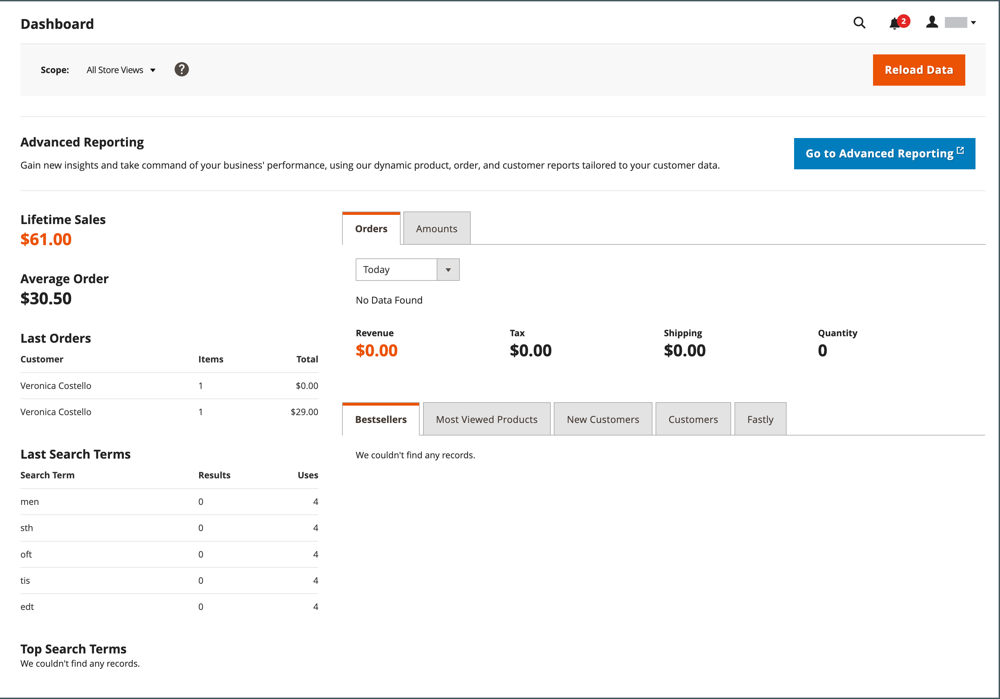

# Was ist der Administrator?

Ihr Store _Admin_ ist das passwortgeschützte Backoffice, in dem Sie als Händler Produkte und Werbeaktionen einrichten, Bestellungen verwalten und andere administrative Aufgaben ausführen. Alle grundlegenden Konfigurationsaufgaben und Speicherverwaltungsvorgänge werden über den _Admin_ ausgeführt.

{{$include /help/_includes/admin-unified-experience-note.md}}

Für zusätzliche Sicherheit ist die _Admin_-Anmeldung durch [Zwei-Faktor-Authentifizierung](../systems/security-two-factor-authentication.md) geschützt und kann so konfiguriert werden, dass ein [CAPTCHA) &#x200B;](../systems/security-captcha.md). Weitere Informationen finden Sie unter &quot;[&#x200B; von Admin Security](../systems/security-admin.md).

{width="700" zoomable="yes"}

Ihre [&#x200B; Anmeldedaten &#x200B;](admin-signin.md) während der Installation von Adobe Commerce oder Magento Open Source eingerichtet. Wenn Sie Ihr Kennwort vergessen haben, kann ein temporäres Kennwort an die mit dem Konto verknüpfte E-Mail-Adresse gesendet werden. Um die Sicherheit zu erhöhen, konfigurieren Sie Ihren Store so, dass ein Benutzername und ein starkes Kennwort unter Berücksichtigung der Groß-/Kleinschreibung erforderlich sind.

Zusätzlich zum standardmäßigen Admin-Benutzerkonto kann Ihr Unternehmen so viele [zusätzliche Konten“ erstellen, &#x200B;](../systems/permissions-users-all.md) Sie für die Verwaltung des Stores und der Support-Kundenkonten benötigen. Jedes Konto kann basierend auf dem &quot;_wissen“ mit einer bestimmten [Rolle](../systems/permissions-user-roles.md) und Zugriffsebene_ werden. Die E-Mail-Adresse, die mit jedem Admin-Benutzerkonto verknüpft ist, muss eindeutig sein.

{{ims-admin-note}}

## Nutzungsdatenerfassung

Wenn Sie sich zum ersten Mal bei _Admin_ anmelden, werden Sie aufgefordert, Adobe die Berechtigung zum Erfassen von Nutzungsdaten für alle Admin-Benutzer zu erteilen. Durch die Ermöglichung der Datenerfassung durch Administratoren können Sie Adobe bei der Verbesserung der Nutzung von Adobe Commerce Admin und zugehörigen Produkten und Services unterstützen.

{width="600"}

Einzelne Benutzende werden in den Nutzungsdaten nicht identifiziert. Ihre Datenerfassungseinstellung kann jederzeit über die Konfiguration [Admin Usage“ &#x200B;](../configuration-reference/advanced/admin.md#admin-usage) werden.

Für Adobe Commerce ermöglicht die Datenerfassung auch _Produktinterne Anleitung_ die dem Administrator interaktive Inhalte __. Es bietet Hilfe, QuickInfos, Anleitungen zu schrittweisen Anleitungen, Onboarding-Informationen, Ankündigungen zu Funktionen und mehr.
