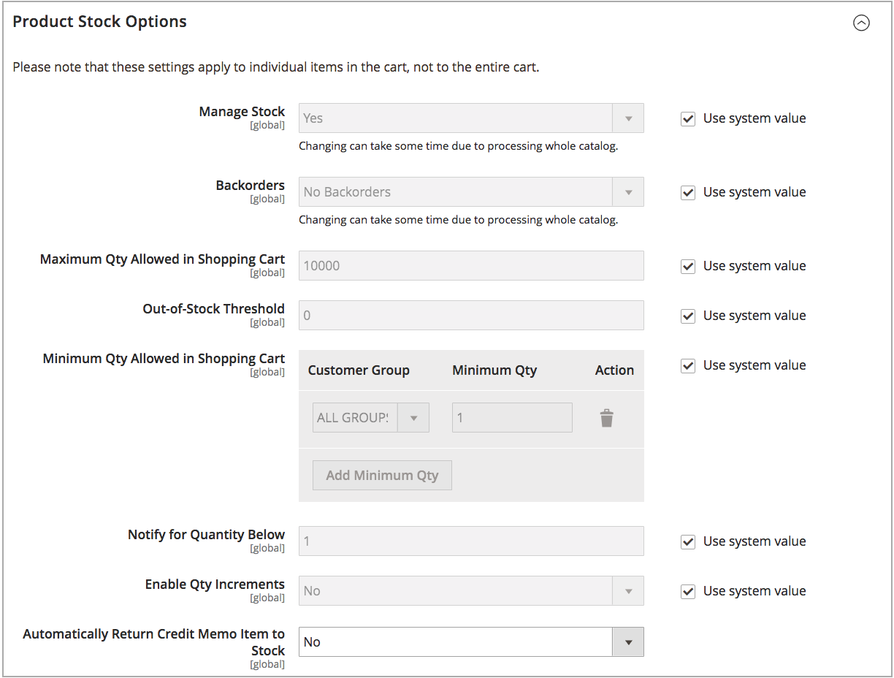

# [!DNL Inventory Management] aktivieren

Um Ihren Produktbestand zu verwalten, aktivieren Sie [!DNL Inventory Management] auf globaler Store- oder Produktebene. Wenn die Option _Lager verwalten_ aktiviert ist, verfolgt [!DNL Inventory Management] automatisch die für die Site verfügbaren Produktmengen über konfigurierte Lager und Quellen. Jede Funktion und Option beginnt mit dem Tracking und Reporting, wenn sie aktiviert sind, ohne zusätzliche Konfiguration.

Wenn [!DNL Inventory Management] aktiviert ist, wird der Bestand mit Ihrer Verkaufsaktivität aktualisiert:

- Die Verkaufsmengen werden pro Lager aktualisiert, wenn Kunden Produkte in den Warenkorb legen, den Checkout abschließen und wenn Sie Bestellungen versenden oder zurückerstatten.
- Neue oder übertragene Lagerbestände an einer Quelle stehen nach der Mengenaktualisierung für Online-Verkäufe zur Verfügung.
- Rückstände berücksichtigen konfigurierte Schwellenwerte ohne zusätzliche Einrichtung.
- Sie können Teil- oder Volllieferungen aus einer oder mehreren Quellen mithilfe von Algorithmusempfehlungen oder manueller Quellauswahl erstellen.

>[!NOTE]
>
>Standardmäßig ist [!DNL Inventory Management] bei der Installation oder Aktualisierung von [!DNL Commerce] aktiviert. Je nach Ihren Geschäftsanforderungen können Sie die verfolgten [!DNL Inventory Management] in [!DNL Commerce] aktivieren oder deaktivieren.

Funktionsweise dieser Einstellung in Inventaren aus einzelnen und mehreren Quellen:

- Um [!DNL Inventory Management] zu verwenden, aktivieren Sie _[!UICONTROL Manage Stock]_.

- [!UICONTROL Manage Stock] Einstellungen auf Produktebene setzen die Store-Konfiguration außer Kraft.

- Um Order Management oder Drittanbieterdienste (wie ERP) zu verwenden, deaktivieren Sie [!UICONTROL Manage Stock].

- Wenn die Konfiguration auf Produktebene den Systemstandard verwendet, überschreibt die Store-Konfiguration.

Wenn [!DNL Inventory Management] aktiviert ist, können Sie alle Einstellungen wie folgt konfigurieren:

- [Konfigurieren von globalen Optionen](global-options.md) - Einstellungen, die sich auf Ihren gesamten Katalog auswirken, gelten als Systemstandardeinstellungen.

- [Konfigurieren von Produktoptionen](product-options.md) - Einstellungen für ein bestimmtes Produkt, die globale Optionen überschreiben.

## Aktivieren oder Deaktivieren von [!DNL Inventory Management]

1. Navigieren Sie in _Admin_-Seitenleiste zu **[!UICONTROL Stores]** > _[!UICONTROL Settings]_>**[!UICONTROL Configuration]**.

1. Erweitern Sie im linken Bereich **[!UICONTROL Catalog]** und wählen Sie **[!UICONTROL Inventory]**.

1. Erweitern Sie  _Produktlageroptionen_ und konfigurieren Sie:

   {width="600" zoomable="yes"}

   - Um den Bestand zu verwalten und alle [!DNL Commerce] Funktionen zu verwenden, setzen Sie **[!UICONTROL Manage Stock]** auf `Yes` (Standard).

   - Um [!DNL Inventory Management] zu deaktivieren, deaktivieren Sie das Kontrollkästchen **[!UICONTROL Use system value]** und setzen **[!UICONTROL Manage Stock]** auf `No`.

1. Klicken Sie abschließend auf **[!UICONTROL Save Config]**.

## Verwalten von Lagern für ein Geschäft

Siehe [Konfigurieren globaler Optionen](global-options.md).

## Verwalten des Lagerbestands für ein Produkt

Siehe [Konfigurieren von Produktoptionen](product-options.md).
