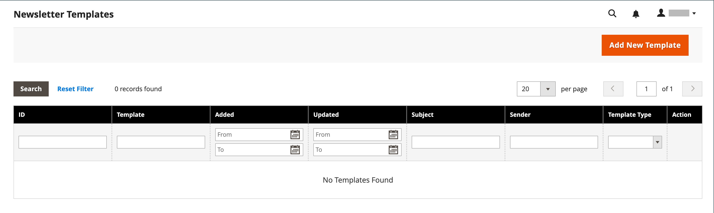
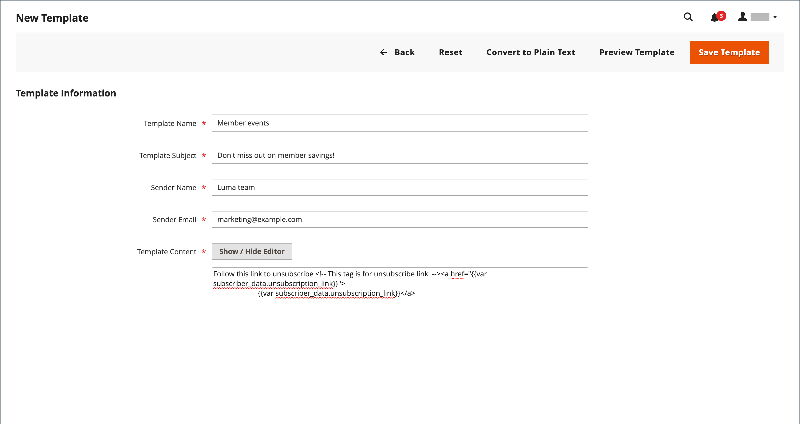

# Newsletter-Vorlagen

Sie können so viele Newsletter-Vorlagen erstellen, wie Sie für verschiedene Zwecke benötigen. Sie können wöchentliche Produktaktualisierungen, monatliche Newsletter oder jährliche Feiertage-Newsletter versenden. Newsletter-Vorlagen können mit HTML-Markup oder als reiner Text vorbereitet werden. Im Gegensatz zu HTML enthalten Nur-Text-Newsletter keine Bilder, Rich-Text oder formatierten Links. Im Raster gibt die Spalte Vorlagentyp an, ob es sich bei einer Vorlage um HTML oder Text handelt.

{width="700" zoomable="yes"}

## Erstellen einer Newsletter-Vorlage

1. Navigieren Sie in der Seitenleiste Admin zu **[!UICONTROL Marketing]** > _[!UICONTROL Communications]_>**[!UICONTROL Newsletter Template]**.

1. Um eine Vorlage hinzuzufügen, klicken Sie auf **[!UICONTROL Add New Template]**.

1. Vervollständigen Sie die Vorlageneinstellungen:

   - Geben Sie **[!UICONTROL Template Name]** den Namen für die interne Referenz ein.

   - Beschreiben Sie **[!UICONTROL Template Subject]** den Zweck des Newsletters.

   - Geben Sie **[!UICONTROL Sender Name]** den Namen der Person ein, die als Absender des Newsletters angezeigt werden soll.

   - Geben Sie **[!UICONTROL Sender Email]** die E-Mail-Adresse des Newsletter-Absenders ein.

   {width="600" zoomable="yes"}

   - Klicken Sie **[!UICONTROL Template Content]** auf **[!UICONTROL Show / Hide Editor]** , um den WYSIWYG-Editor anzuzeigen und die Inhalte nach Bedarf zu aktualisieren.

     Weitere Informationen finden Sie unter [Verwenden des Editors](../content-design/editor.md).

     >[!NOTE]
     >
     >Entfernen Sie nicht den Abmelde-Link am unteren Rand des Vorlageninhalts. In einigen Rechtssystemen ist die Verknüpfung gesetzlich vorgeschrieben.

   - Geben Sie **[!UICONTROL Template Styles]** die zum Formatieren des Inhalts erforderlichen CSS-Deklarationen ein.

1. Klicken Sie auf **[!UICONTROL Preview Template]** , um zu sehen, wie es aussieht, und nehmen Sie die erforderlichen Änderungen vor.

1. Klicken Sie abschließend auf **[!UICONTROL Save Template]**.

   Nachdem Sie eine Vorlage gespeichert haben, wird **[!UICONTROL Save As]** angezeigt, wenn Sie die Vorlage das nächste Mal bearbeiten. Damit können Sie Varianten der Vorlage speichern, ohne das Original zu überschreiben.

## Konvertieren der Vorlage in einfachen Text

1. Klicken Sie oben auf der Seite auf **[!UICONTROL Convert to Plain Text]** und klicken Sie bei Aufforderung auf **[!UICONTROL OK]**.

1. Um eine Vorschau der Nur-Text-Version der Vorlage anzuzeigen, klicken Sie auf **[!UICONTROL Preview Template]**.

   Die Vorschau wird in einer neuen Browser-Registerkarte geöffnet.

1. Um die Nur-Text-Version zu speichern, klicken Sie auf **[!UICONTROL Save Template]**.

## HTML wiederherstellen

1. Klicken Sie oben auf der Seite auf **[!UICONTROL Return HTML Version]**.  

1. Um eine Vorschau der HTML-Version der Vorlage anzuzeigen, klicken Sie auf **[!UICONTROL Preview Template]**.

   Die Vorschau wird in einer neuen Browser-Registerkarte geöffnet.

1. Um die HTML-Version zu speichern, klicken Sie auf **[!UICONTROL Save Template]**.

## Löschen einer Newsletter-Vorlage

1. Navigieren Sie in _Admin_-Seitenleiste zu **[!UICONTROL Marketing]** > _[!UICONTROL Communications]_>**[!UICONTROL Newsletter Template]**.

1. Suchen Sie die zu löschende Newsletter-Vorlage und öffnen Sie sie im Bearbeitungsmodus.

1. Klicken Sie in der Menüleiste auf die Schaltfläche **[!UICONTROL Delete Template]** .

1. Um die Aktion zu bestätigen, klicken Sie auf **[!UICONTROL OK]**.

## Rasterspalten

| Spalte | Beschreibung |
|--- |--- |
| [!UICONTROL ID] | Eine eindeutige numerische Kennung, die jeder Newsletter-Vorlage zugewiesen wird |
| [!UICONTROL Template] | Der Name der Vorlagenentität |
| [!UICONTROL Added] | Das Datum, an dem die Vorlagenentität erstellt wurde |
| [!UICONTROL Updated] | Das Datum, an dem die Vorlagenentität zuletzt aktualisiert wurde |
| [!UICONTROL Subject] | Betreff der Newsletter-Vorlage |
| [!UICONTROL Sender] | Kontaktinformationen für den Absender |
| [!UICONTROL Template Type] | Der Vorlagentyp: `html` oder `text` |
| [!UICONTROL Actions] | **[!UICONTROL Preview]**: Öffnet ein separates Fenster zur Vorschau der Vorlage  **[!UICONTROL Queue Newsletter]**: Stellt die Newsletter-Vorlage in die Versandwarteschlange. |

{style="table-layout:auto"}
