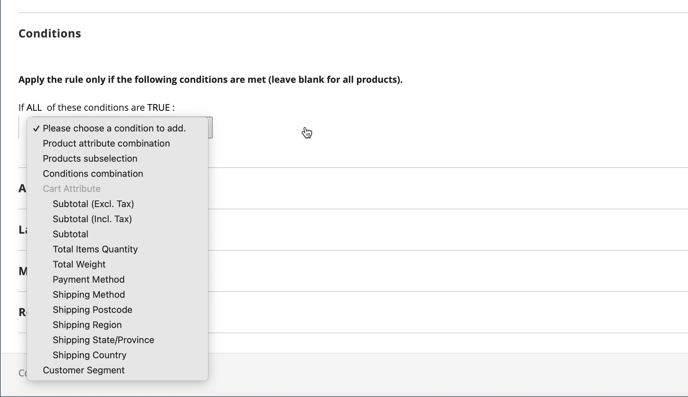
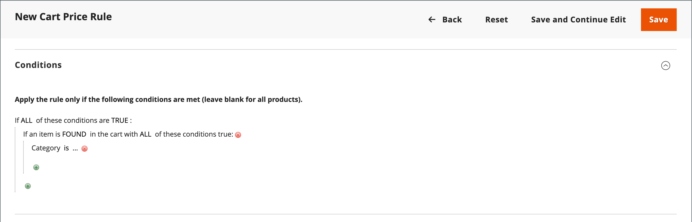
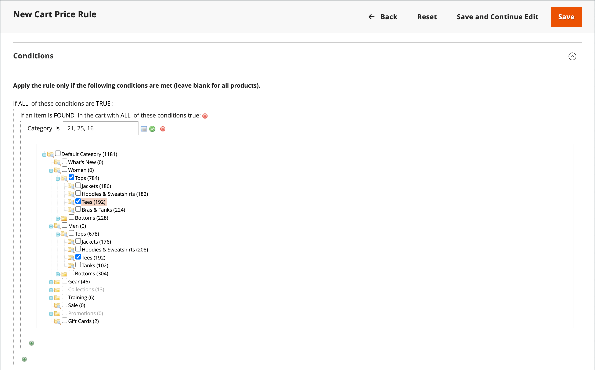
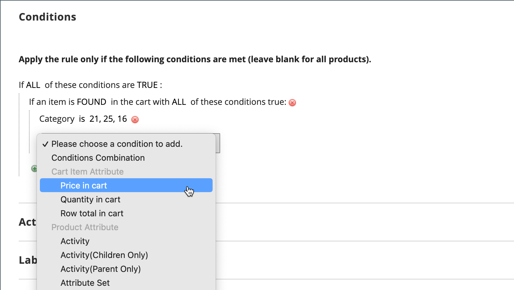
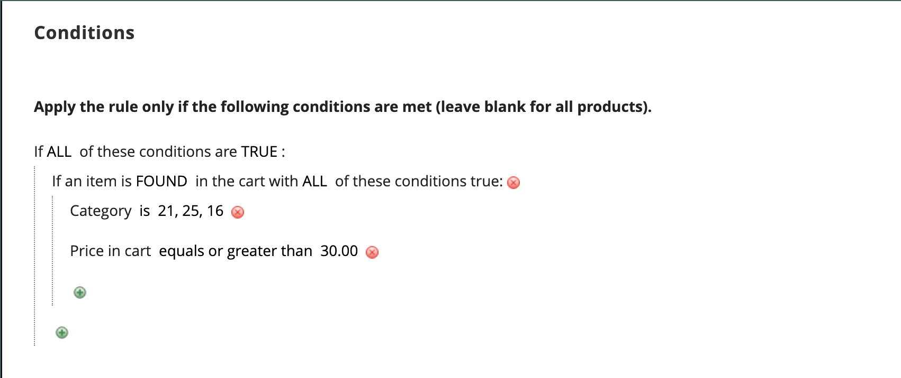
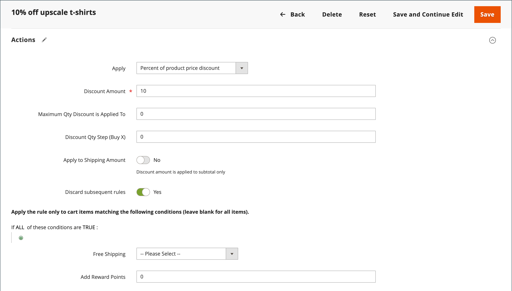

# Beispiel für Warenkorbpreisregel - Rabatt mit Mindestproduktpreis

Regeln für den Warenkorbpreis können verwendet werden, um einen prozentualen Rabatt auf der Grundlage eines Mindestproduktpreises im Warenkorb anzubieten. Im folgenden Beispiel wird ein Rabatt von 10 % auf alle Produkte im gesamten Warenkorb angewendet, wenn mindestens 1 Produkt mit einem Preis über 30,00 $ aus einer bestimmten Kategorie zum Warenkorb hinzugefügt wird. Der Rabatt hat folgendes Format:

X% ganzer Warenkorb ab, wenn mindestens 1 Produkt aus der Kategorie Y stammt und sein Preis über $Z Dollar liegt.

## Schritt 1. Erstellen einer Warenkorbregel

Befolgen Sie die grundlegenden [Anweisungen](price-rules-cart.md), um eine Warenkorbregel zu erstellen.

## Schritt 2. Definieren der Bedingungen

1. Scrollen Sie nach unten und erweitern Sie  den Abschnitt **[!UICONTROL Conditions]** .

1. Klicken Sie _Hinzufügen_ () und wählen Sie **[!UICONTROL Product Attribute Combination]** aus.

   {width="500" zoomable="yes"}

1. Klicken Sie _Hinzufügen_ () am Anfang der nächsten Zeile und wählen Sie in der Liste unter **[!UICONTROL Product Attribute]** die Option **[!UICONTROL Category]** aus.

   - Klicken Sie auf den Link (**…**) _mehr_, um zusätzliche Optionen anzuzeigen.

     {width="600" zoomable="yes"}

   - Klicken Sie auf _Auswahl_ (), um die verfügbaren Kategorien anzuzeigen. Aktivieren Sie in der Kategoriestruktur das Kontrollkästchen jeder Kategorie, die Sie einbeziehen möchten. Klicken Sie auf das Häkchensymbol, um die Kategorieauswahl zu akzeptieren.

     {width="600" zoomable="yes"}

1. Klicken Sie _Hinzufügen_ () am Anfang der nächsten Zeile und führen Sie folgende Schritte aus:

   - Wählen Sie in der Liste unter **[!UICONTROL Cart Item Attribute]** die Option **[!UICONTROL Price in cart]** aus.

     {width="500"}

   - Klicken Sie auf **is** und wählen Sie `equals or greater than`.

   - Klicken Sie auf **…** und geben Sie den Betrag ein, den der Preis im Warenkorb aufweisen muss, um die Bedingung zu erfüllen. Geben Sie beispielsweise `30` ein.

     {width="500"}

1. Klicken Sie auf **[!UICONTROL Save and Continue Edit]**.

## Schritt 3. Definieren der Aktionen

1. Erweitern Sie  den Abschnitt **[!UICONTROL Actions]** und führen Sie folgende Schritte aus:

   {width="600" zoomable="yes"}

   - Legen Sie **[!UICONTROL Apply]** auf `Percent of product price discount` fest.

   - Geben Sie die **[!UICONTROL Discount Amount]** ein. Geben Sie beispielsweise `10` für einen Rabatt von 10 % ein.

   - Um zu verhindern, dass zusätzliche Promotions auf den Kauf angewendet werden, setzen Sie **[!UICONTROL Discard subsequent rules]** auf `Yes`.

1. Klicken Sie auf **[!UICONTROL Save and Continue Edit]** und füllen Sie die Regel nach Bedarf aus.

## Schritt 4. Vervollständigen Sie die Beschriftungen

Führen Sie [Schritt 4](price-rules-cart.md) der Anleitung zur Warenkorbpreisregel aus, um alle Beschriftungen einzugeben, die während des Checkouts angezeigt werden.

## Schritt 5: Speichern und Testen der Regel

{{new-price-rule}}

1. Wenn Ihre Regel abgeschlossen ist, klicken Sie auf **[!UICONTROL Save Rule]**.
1. Testen Sie die Regel, um sicherzustellen, dass sie korrekt funktioniert.
