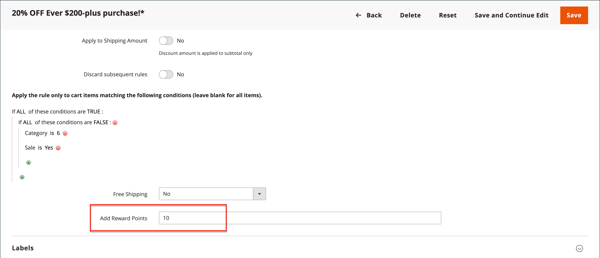

# Prämienpunkte in Preisregeln

{{ee-feature}}

Prämienpunkte können Kunden gemäß einer [Warenkorbpreisregel) &#x200B;](price-rules-cart.md). Die Vergabe von Punkten kann die einzige Aktion der Preisregel sein oder mit einem Rabatt verwendet werden.

>[!NOTE]
>
>[Rewards-Wechselkurse](reward-exchange-rates.md) Die Konfiguration ist erforderlich, um Prämienpunkte von Kunden und Admin-Benutzern während des Checkouts einzulösen.

## Prämienpunkte zu einer Preisregel hinzufügen

1. Navigieren Sie in _Admin_-Seitenleiste zu **[!UICONTROL Marketing]** > _[!UICONTROL Promotions]_>**[!UICONTROL Cart Price Rules]**.

1. Klicken Sie auf **[!UICONTROL Add New Rule]** , um eine Warenkorb-Preisregel zu erstellen, oder klicken Sie auf eine vorhandene Warenkorb-Preisregel, um sie zu öffnen.

1. Scrollen Sie nach unten, erweitern Sie  den Abschnitt **[!UICONTROL Actions]**, legen Sie die Bedingungen fest und geben Sie die Anzahl der Punkte in das Feld **[!UICONTROL Add Reward Points]** ein.

   {width="600" zoomable="yes"}

1. Befolgen Sie die Standardanweisungen, um die [Warenkorbpreisregel“ &#x200B;](price-rules-cart-create.md).

   Wenn die Preisregel aktiviert ist, wird im Warenkorb eine Meldung angezeigt, die den Kunden mitteilt, wie viele Punkte sie durch die Bestellung verdienen können. Dies gilt nur für registrierte Benutzer und kann sich ändern, wenn ein Benutzer angemeldet ist.
