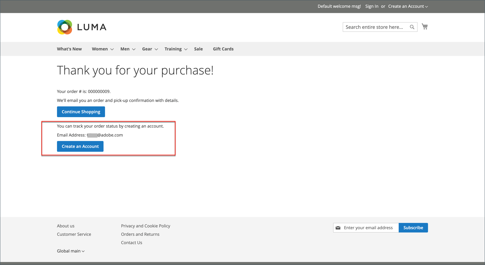

# Gast-Checkout

Ihr Store kann so konfiguriert werden, dass Käufer vor einem Kauf ein Konto eröffnen müssen. In der Standardeinstellung können Gäste Einkäufe tätigen. Nach Abschluss des Checkout-Prozesses können sie sich für ein Konto registrieren lassen.

{width="600" zoomable="yes"}

**_So deaktivieren Sie den Gast-Checkout:_**

1. Navigieren Sie in der _Admin_-Seitenleiste zu **[!UICONTROL Stores]** > **[!UICONTROL Configuration]**.

1. Erweitern Sie im linken Bereich **[!UICONTROL Sales]** und wählen Sie **[!UICONTROL Checkout]**.

1. Erweitern Sie  den Abschnitt **[!UICONTROL Checkout Options]** .

   {width="700" zoomable="yes"}

Eine ausführliche Beschreibung jeder dieser Konfigurationseinstellungen finden Sie unter [Checkout-Optionen](../configuration-reference/sales/checkout.md#checkout-options) im _Konfigurationsreferenzhandbuch_.

1. Wenn die Einstellung für eine bestimmte Store-Ansicht ist, wählen [die Store-Ansicht aus](../configuration-reference/scope-change.md#set-the-scope) für die die Konfiguration gilt.

   Wenn Sie dazu aufgefordert werden, klicken Sie auf **[!UICONTROL OK]** , um fortzufahren.

1. Legen Sie **[!UICONTROL Allow Guest Checkout]** auf `No` fest.

   Deaktivieren Sie bei Bedarf das Kontrollkästchen **[!UICONTROL Use system value]** , um Änderungen an dieser Einstellung zu aktivieren.

1. Klicken Sie auf **[!UICONTROL Save Config]**.

## Zugriff auf Gastbestellungen für registrierte E-Mails zulassen

[!BADGE nur SaaS]{type=Positive url="https://experienceleague.adobe.com/en/docs/commerce/user-guides/product-solutions" tooltip="Gilt nur für Adobe Commerce as a Cloud Service-Projekte (von Adobe verwaltete SaaS-Infrastruktur)."}

Eine optionale Konfiguration auf Store-Ebene, die standardmäßig deaktiviert ist, ermöglicht es Kunden, ihre Bestellungen über eine E-Mail-Adresse zu verfolgen, die mit einem registrierten Kundenkonto übereinstimmt.

Wenn diese Option aktiviert ist, bleiben Gast-Checkout-Bestellungen, die mit einer registrierten E-Mail aufgegeben werden, weiterhin zugänglich und werden auch im Bestellverlauf des Kunden angezeigt.

Um diese Funktion zu aktivieren, navigieren Sie zu **[!UICONTROL Stores]** > **[!UICONTROL Configuration]** > **[!UICONTROL Sales]** > **[!UICONTROL Sales]** > **[!UICONTROL Guest Checkout]** und legen Sie die **[!UICONTROL Allow Guest Order Access for Registered Emails]** auf `Yes` fest.
