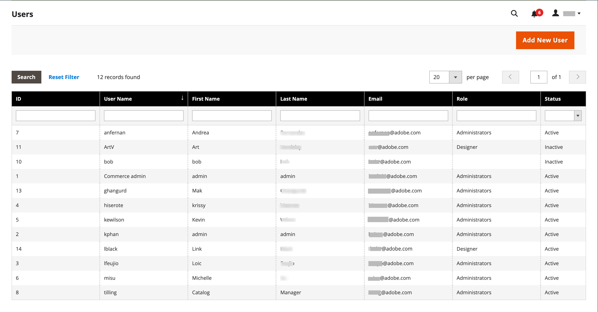

# Administratorberechtigungen

Adobe Commerce und Magento Open Source verwenden Rollen und Berechtigungen, um verschiedene Zugriffsebenen für den Administrator zu erstellen. Wenn Ihr Store zum ersten Mal eingerichtet wird, erhalten Sie einen Satz von Anmeldeinformationen für die Administratorrolle, die über vollständige Berechtigungen verfügt. Sie können jedoch die Berechtigungsstufe für andere Personen, die auf Ihrer Site arbeiten, auf der Grundlage „Wissen erforderlich“ einschränken. Beispielsweise kann einem Mitglied des Design-Teams nur Zugriff auf die Inhaltsdesign-Tools gewährt werden, nicht jedoch auf Bereiche mit Kunden- und Bestellinformationen.

Darüber hinaus können Sie den Admin-Zugriff auf eine bestimmte Site oder eine Reihe von Sites und die zugehörigen Daten weiter einschränken. Wenn Sie mehrere Marken oder Geschäftseinheiten mit separaten Stores in derselben Commerce-Installation haben, können Sie jedem Geschäftsbereich Administratorzugriff gewähren, aber dessen Daten vor anderen Admin-Benutzern ausblenden und schützen.

Wenn der Zugriff eines Admin-Benutzers auf eine bestimmte Website oder einen bestimmten Store beschränkt ist, sind die Seiten, für die er nicht berechtigt ist, entweder nicht sichtbar oder werden ausgegraut angezeigt. Für den Nutzer werden nur die Verkaufs- und sonstigen Daten für erlaubte Websites und Stores angezeigt.

-  (nur Adobe Commerce) Standardmäßig protokolliert das System automatisch alle von einem Benutzer durchgeführten Aktionen, wenn er Änderungen auf einen Store anwendet (aufzeichnet). Admin-Aktionen können im Bericht [Aktionsprotokolle“ überprüft ](action-log-report.md). Konfigurieren Sie die Anmeldung [Admin-](action-log.md)-Protokollierung) in den erweiterten Administratoreinstellungen Ihres Stores.

{width="700" zoomable="yes"}
