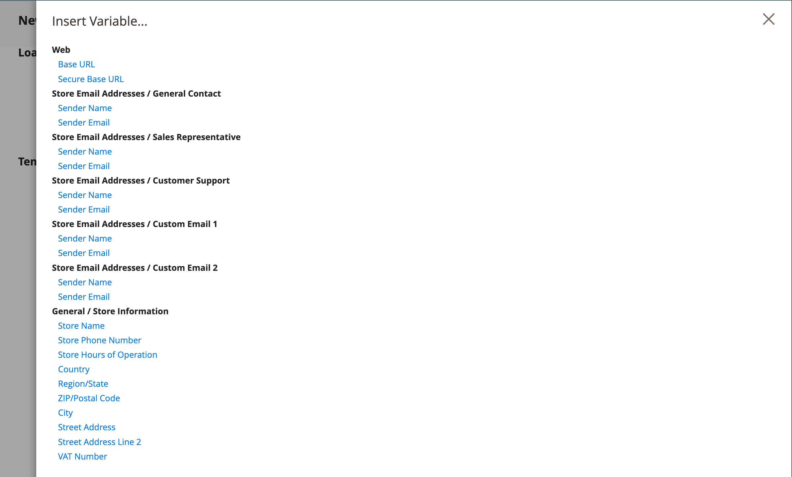
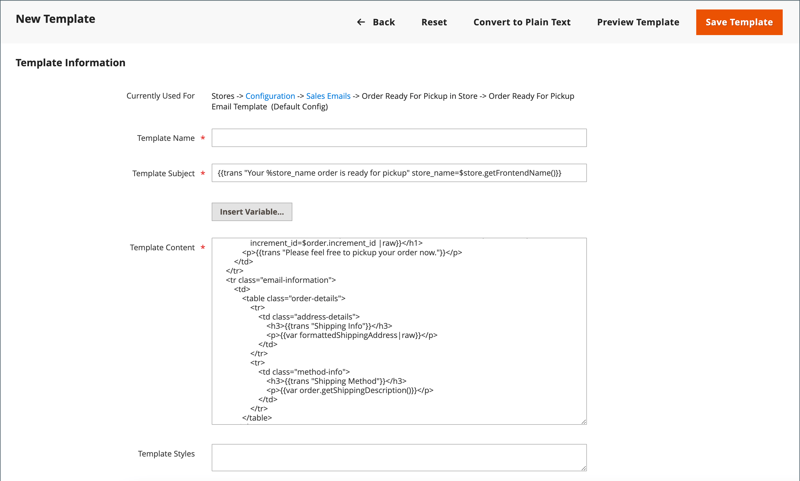
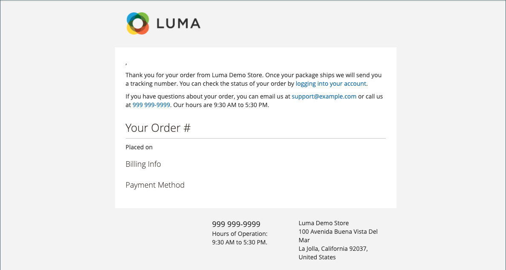

# Vordefinierte Variablen verwenden

[Vordefinierte](variables-predefined.md) Variablen erleichtern die Personalisierung von [E-Mail](email-templates.md)- und [Newsletter](../merchandising-promotions/newsletters.md)-Vorlagen und anderen Inhaltstypen. Die Liste der zulässigen [vordefinierten](variables-predefined.md) Variablen wird angezeigt, wenn Sie auf die Schaltfläche Variable einfügen klicken. Wie in der folgenden Abbildung dargestellt, wird die Liste der verfügbaren Variablen für eine bestimmte E-Mail-Vorlage durch die Daten bestimmt, die mit der Vorlage verknüpft sind. Unter [Variablenreferenz](variables-reference.md) finden Sie eine Liste der häufig verwendeten E-Mail-Vorlagen und der zugehörigen Variablen.

{width="700" zoomable="yes"}

## Hinzufügen einer Variablen zu einer E-Mail-Vorlage

1. Navigieren Sie in _Admin_-Seitenleiste zu **[!UICONTROL Marketing]** > _[!UICONTROL Communications]_>**[!UICONTROL Email Templates]**.

1. Führen Sie einen der folgenden Schritte aus:

   - Um die Variable zu einer vorhandenen Vorlage hinzuzufügen, klicken Sie auf die Vorlage in der Liste, um sie im Bearbeitungsmodus zu öffnen.

   - Um die Variable in einer neuen Vorlage zu verwenden, klicken Sie auf **[!UICONTROL Add New Template]** und passen Sie den Code der Standardvorlage an. Siehe [Nachrichtenvorlagen](email-template-custom.md#message-templates).

1. Wählen Sie unter _[!UICONTROL Load default template]_&#x200B;die **[!UICONTROL Template]**&#x200B;aus, die Sie anpassen möchten.

1. Um eine Vorlage anzuwenden, klicken Sie auf **[!UICONTROL Load Template]**.

   Das Feld _[!UICONTROL Currently used for]_&#x200B;zeigt den Konfigurationspfad für die Vorlage an. Die&#x200B;_[!UICONTROL Template Subject]_ und _[!UICONTROL Template Content]_&#x200B;werden automatisch relativ zur ausgewählten Vorlage generiert.

   - **[!UICONTROL Template Subject]** - Dieser Text wird in der Betreffzeile einer E-Mail angezeigt.

   - **[!UICONTROL Template Content]** - Dieser Text wird im vollständigen Inhalt der gesendeten E-Mail angezeigt.

   {width="600" zoomable="yes"}

1. Geben Sie einen **[!UICONTROL Template Name]** ein.

1. Eine Liste der [vordefinierten](variables-predefined.md) Variablen, die mit dieser E-Mail-Vorlage verwendet werden können, finden Sie **[!UICONTROL Insert Variable]**.

   Bestimmen Sie, welche Variable Sie in die Vorlage einfügen möchten. Klicken Sie dann _Schließen_ (X) in der oberen rechten Ecke. (Sie kehren später hierauf zurück.)

1. Um ein Modell der Vorlage anzuzeigen, klicken Sie in der Schaltflächenleiste auf **[!UICONTROL Preview Template]** .

   Wenn die Vorschau auf einer neuen Registerkarte geöffnet wird, legen Sie fest, wo die Variable in Bezug auf den anderen Inhalt platziert werden soll. Kehren Sie dann zur ursprünglichen Registerkarte zurück, um fortzufahren.

   {width="600" zoomable="yes"}

1. Positionieren Sie im **[!UICONTROL Template Content]** die Einfügemarke an der Stelle, an der die Variable angezeigt werden soll, und klicken Sie auf **[!UICONTROL Insert Variable...]**.

1. Klicken Sie in der Liste der verfügbaren Variablen auf die Variable, die Sie in die Vorlage einfügen möchten.

1. Klicken Sie abschließend auf **[!UICONTROL Save Template]**.

## Konvertieren der Vorlage in einfachen Text

1. Öffnen Sie eine Vorlage im Bearbeitungsmodus.

1. Klicken Sie oben auf der Seite auf **[!UICONTROL Convert to Plain Text]**.

1. Wenn Sie zum Entfernen von Tags aufgefordert werden, klicken Sie auf **[!UICONTROL OK]**.

1. Um die Nur-Text-Version zu speichern, klicken Sie auf **[!UICONTROL Save Template]**.

## HTML-Version wiederherstellen

1. Klicken Sie oben auf der Seite auf **[!UICONTROL Return HTML Version]**.

1. Um die HTML-Version der Vorlage zu speichern, klicken Sie auf **[!UICONTROL Save Template]**.
